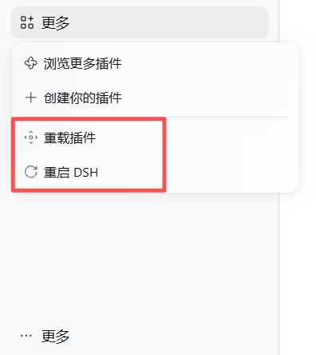

# dsh-restart

给 [DeepSeek Harness](https://github.com/deepseek-ai/deepseek-harness)（DSH）的侧边栏「更多」菜单加两行：

- **重载插件**：改完插件或配置，一点就生效。连接不断、页面不刷新、会话不丢。
- **重启 DSH**：干净退出，由 systemd 立刻拉起，页面自动重连。

本插件适用于 Linux 系统下的 DSH：重载随时可用；重启依赖 systemd，需要 DSH 由 systemd 托管并设置 `Restart=always`。

一句话：**能重载就别重启，必须重启时重启得干净。**

> English summary at the end.

## 安装

要求：DSH 0.2.x（≥ `0.2.2-rc.5`）。

1. 打开 DSH 的 **插件（Plugins）→ 添加插件（Add plugin）**。
2. 输入仓库地址 `https://github.com/wellsoren/dsh-restart`；也可以先 `git clone` 再选本地目录。
3. 安装并启用后刷新一次页面，菜单才会出现。
4. 让 systemd 在 DSH 退出后自动拉起（一次性）。执行一次 `/restart`：如果还没配好，插件会查出主管当前进程的 unit，把要执行的命令原样告诉你，复制执行即可（非 systemd 环境则只提示不支持重启）。

没配好也没关系：重启行会变红并拒绝执行，不会把服务停掉；配好后再点一次即可恢复。

## 使用

侧边栏面板列表的「更多」菜单底部多了两行：

| 菜单项 | 行为 |
| --- | --- |
| 重载插件 | 点击立即执行，结果显示在行内，约 1.5 秒后菜单收起 |
| 重启 DSH（空闲） | 第一次点击只检查，变成「再次点击以重启 / 3 秒内有效」；3 秒内再点才执行 |
| 重启 DSH（有代理运行） | 变成琥珀色警示「确认中断并重启 / N 个代理正在运行」；再点才执行 |
| 重启 DSH（条件不满足） | 变红并说明原因；修好后可以再点一次重新检查 |

菜单不方便用时，也可以直接发命令：

| 命令 | 作用 |
| --- | --- |
| `/reload` | 立即重载插件与配置 |
| `/restart` | 检查后重启；有代理运行时拒绝并提示 |
| `/restart now` | 强制重启（跳过代理检查，仍校验 systemd） |
| `/restart check` | 只检查，不重启 |
| `/restart status` | 查看 unit、`Restart` 配置、MainPID、运行中代理数 |

几点说明：

- 重启期间页面会短暂断线，恢复后自动重连，不需要刷新；被中断的回合不会自动续跑。
- 每次操作都会在当前会话留下一条命令卡片（例如 `/restart check · 可以重启…`），方便回看。
- 菜单文案跟随界面语言（中/英）；命令输出固定中文。

## 工作原理

- 菜单动作走 DSH 的命令通道，不额外开 HTTP 接口。
- 重载 = 宿主 HMR 的 `reconcileProfile()`：只替换能就地替换的模块，需要整体重启时会明确提示。
- 重启 = 先确认当前 unit 的 `LoadState=loaded` 且 `Restart=always`，再 `appExit(0)`；unit 从 `/proc/self/cgroup` 自动识别，不写死名字。
- 非 systemd 环境（容器、用户级 scope）只提供重载，重启会被拒绝并说明原因。

## 已知限制

- 重启会中断正在运行的回合和子代理，且不会自动续跑。
- 只重启主管本进程的那个 systemd unit，不处理其他服务。
- 能打开 GUI 的人都能触发重启（DSH 单用户模型），不要把 DSH 暴露给不信任的人。
- 重载不是万能的：宿主模块或未托管的插件会继续跑旧代码，提示「需整体重启」时请用重启。

## 问题与建议

遇到问题请开 [Issue](https://github.com/wellsoren/dsh-restart/issues)；PR 也欢迎。

## English

**dsh-restart** is built for DSH on Linux. It adds two rows to the sidebar "More" menu: **Reload plugins** (apply changed plugins and config in place, no process restart) and **Restart DSH** (graceful exit, then systemd brings it back).

Requires DSH 0.2.x (≥ `0.2.2-rc.5`); restart needs DSH managed by systemd with `Restart=always`.

1. In DSH, open **Plugins → Add plugin**.
2. Enter `https://github.com/wellsoren/dsh-restart` (or clone the repo and pick the local directory), then enable it and refresh the page once.
3. Run `/restart` once. If the unit is not configured yet, the plugin prints the exact systemd drop-in command for the unit that supervises DSH — copy, run, done.

Commands: `/reload`, `/restart`, `/restart now`, `/restart check`, `/restart status`.

## License

[MIT](LICENSE)
